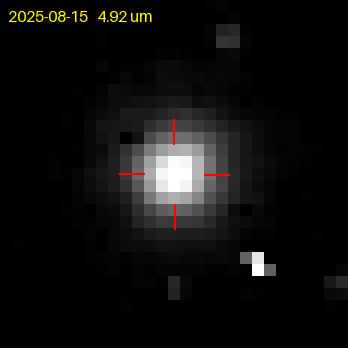

# Moving Pictures

[](https://moving-pictures.streamlit.app/)
[](https://www.spaceappschallenge.org/)
[](https://www.python.org/)
[](https://streamlit.io/)
[](https://www.astropy.org/)
[](https://irsa.ipac.caltech.edu/)
[](https://irsa.ipac.caltech.edu/Missions/wise.html)
[](LICENSE)

**Blink SPHEREx infrared images through time to spot stars that move or change.**

🔭 **Live app:** https://moving-pictures.streamlit.app/

Built by team **Sidereus Nuncius** (Montevideo, Uruguay) for the **NASA Space Apps Challenge 2026**,
challenge *Planet X and SPHEREx*.



---

## What is this?

In 1930, Clyde Tombaugh found Pluto by "blinking" two photographs of the same patch of sky taken
days apart: anything that jumped between them was something nearby that was moving. People still
look for a hypothetical distant "Planet X" the same way.

**Moving Pictures** lets anyone do that with real, recent data from NASA's **SPHEREx** space
telescope, which maps the whole sky in the infrared. You type a position on the sky (or pick one of
five famous objects), and the app downloads SPHEREx images of that spot taken on different dates,
lines them up and plays them as an animation. Stars that move, or that change in brightness, stand out.

The app is meant for **curious people, not specialists**. It tries to *teach* what you're looking
at, not just show it.

---

## How it works

```
 coordinates (RA/Dec)
        │
        ▼
 1. Search    IRSA SIA query, collection spherex_dr1: every SPHEREx image covering that point
        │
        ▼
 2. Select    up to 12 images spread evenly across the observation dates
        │
        ▼
 3. Cutout    download only a cutout of each image (full images are ~62 MB each),
              4 at a time in parallel
        │
        ▼
 4. Align     reproject every cutout onto the same north-up grid; drop cutouts covering
              less than 90%. Two views:
              · Fixed sky: every frame centered on the same point, so the star moves
              · Follow the star: each frame centered on the star at that date
                (proper motion applied), so the background moves
        │
        ▼
 5. Measure   read the observation date (DATE-OBS), the detector, and the wavelength
              at the target's exact pixel (SPHEREx's wavelength changes across each detector)
        │
        ▼
 6. Scale     subtract each frame's sky background, then apply ONE common asinh brightness
              scale to all frames (black just below the sky, white set by the stars or by
              the noise level), so brightness changes are real, not display artifacts
        │
        ▼
 7. Blink     animated GIF with a cross on the target and the date + wavelength on each frame
        │
        ▼
 8. Compare   difference image between two visits (frames of each visit averaged):
              blue where something was, orange where it went
        │
        ▼
 9. Optional  one older image from WISE (AllWISE W2, 4.6 µm, 2010) on the same grid,
              with its own brightness scale, to compare positions 15 years apart
```

Two steps deserve a note:

- **Reprojection is required, not cosmetic.** SPHEREx visits from August 2025 come rotated by about
  180° compared with those from 2026. Without putting every frame on a common north-up grid, the
  blink would be meaningless.
- **Same brightness scale for every frame.** If each image were stretched on its own, a star could
  look brighter or fainter just because of the display. One shared scale avoids that.

---

## The five test objects

The challenge requires five test objects. Positions and proper motions come from
[SIMBAD](https://simbad.cfa.harvard.edu/simbad/) (queried 2026-11-14 via the Harvard mirror).

| Object | Why it's interesting | What to look for |
|---|---|---|
| **Barnard's Star** | The star with the largest proper motion seen from Earth | A small shift relative to background stars |
| **Epsilon Indi B** | A pair of brown dwarfs near the Sun, with high proper motion | A small shift |
| **WISE 0855−0714** | One of the coldest known brown dwarfs, very close to the Sun | Very faint; see [Limitations](#limitations) |
| **RW Aurigae** | A young, irregular variable star | Brightness changes, not motion |
| **R Draconis** | A long-period (Mira-type) variable star | Brightness changes, not motion |

The first three are tested for **motion**; the last two for **variability**.

---

## Features

- **Coordinate input** in decimal degrees (`269.452 4.693`) or sexagesimal
  (`17:57:48.5 +04:41:36`, `17h57m48.5s +04d41m36s`, `17 57 48.5 +04 41 36`).
- **Five one-click test objects**, loaded from saved data and clearly labeled **DEMO MODE**.
- **Live search** of the SPHEREx archive at IRSA for any position (about 1 minute, with a progress
  bar and a clear message when IRSA is not responding).
- **Two views:** *Fixed sky* (watch the star move) and *Follow the star* (the background moves).
- **Field of view:** Close (0.1°), Medium (0.2°) or Far (0.5°).
- **Blink GIF** with a fixed cross on the target, date and wavelength on every frame, and
  adjustable speed (Slow / Medium / Fast).
- **Frame-by-frame slider**, shown with sharp, unsmoothed pixels, with date, wavelength and detector,
  plus a table of all frames (date, telescope, wavelength, detector).
- **Difference image** between two dates (averaged visits or single frames) to make small motions
  visible: blue where the star was, orange where it is now.
- **Optional WISE (2010) image**: with 15 years between images, Barnard's Star moves about
  25 SPHEREx pixels instead of 1.
- **English / Spanish switch** (top right) for the Home, Stories and Learn pages.

### Pages

| Page | What you can do |
|---|---|
| **Home** | Read what the app does and how a blink works; jump to Explore, Stories or Learn. |
| **Explore** | The tool: pick a test object or type coordinates, choose the view and field, watch the blink, compare two dates. |
| **Stories** | One short story per test object (type, distance, magnitude, a "Did you know?" fact) next to its blink. "Explore it yourself" opens that object in Explore. |
| **Learn** | Three short reads: SPHEREx, visual magnitude and infrared light. |
| **About** | Team, data sources and limitations. |

---

## Run it locally

Requires Python 3 (tested on macOS and Windows).

```bash
git clone https://github.com/eltruji04/moving-pictures.git
cd moving-pictures
```

Create and activate a virtual environment:

```bash
# macOS / Linux
python3 -m venv venv
source venv/bin/activate
```

```powershell
# Windows
python -m venv venv
.\venv\Scripts\activate
```

Install the dependencies and start the app:

```bash
pip install -r requirements.txt
streamlit run app.py
```

The app opens at http://localhost:8501.

### Rebuilding the demo data

The demo data for the five test objects lives in `data/demo/*.npz`: SPHEREx frames at 0.5° in
both views (`<object>_fixed.npz`, `<object>_follow.npz`) plus one WISE frame each
(`<object>_<view>_wise.npz`). Smaller fields are cut from the center. Files that already exist are
skipped, so delete them to regenerate. To rebuild from IRSA (slow; needs a good connection):

```bash
python -m scripts.build_demo
```

---

## Repository structure

```
.
├── app.py              # Streamlit entry point: multipage navigation and language switch
├── i18n.py             # English/Spanish texts for Home, Stories and Learn
├── .streamlit/         # config.toml: dark theme and orange accent color
├── views/              # One file per page: home, explore, stories, learn, about
├── core/               # Data side; knows nothing about the web interface
│   ├── spherex.py      # Search, cutouts, alignment, wavelength, common brightness scale
│   ├── wise.py         # One older WISE (2010) comparison frame on the same grid
│   ├── frames.py       # Fake get_frames (random noise) used while developing the UI
│   ├── coords.py       # Parse RA/Dec in decimal or sexagesimal
│   ├── targets.py      # The five test objects (SIMBAD positions and proper motions)
│   ├── animate.py      # Blink GIF, visit averaging and difference image
│   ├── demo.py         # Save/load/crop processed frames for demo mode
│   └── content.py      # Read page texts from content/
├── content/            # Markdown texts in English: home, learn, stories/<object>.md
├── contentEs/          # The same texts in Spanish
├── data/demo/          # Saved frames for the five test objects
├── scripts/            # Demo builder and FITS exploration tools
├── requirements.txt
└── LICENSE
```

The data side and the interface meet at a single function:

```python
get_frames(ra_deg, dec_deg, size_deg, pm_ra_mas_yr=0, pm_dec_mas_yr=0, n_frames=12,
           on_progress=None, track_target=False) -> list[dict]
# each dict: {"image": 2D array (same shape for all), "date": datetime,
#             "wavelength_um": float, "detector": int}  (+ "telescope" for WISE/demo frames)
# returns [] if no data is found; raises if IRSA can't be reached after retries
```

---

## Limitations

We want to be upfront about what this tool can and can't show.

- **The time span is short.** The `spherex_dr1` data we use covers only about 8–9 months
  (August 2025 to May 2026). Even Barnard's Star, the fastest-moving star in the sky, shifts by only
  about **1.2 pixels** in that time (a SPHEREx pixel is ~6.15″). The motion is real but subtle; don't
  expect a star racing across the frame. The difference image and the optional WISE (2010) image
  are there to make it visible.
- **Every frame is at a different wavelength.** SPHEREx is a spectral survey: each image sees a
  slightly different infrared color, and the two detector groups cover roughly 0.75–2.4 µm and
  2.4–5 µm (approximate). A brightness change between frames **can be a color effect, not real
  variability**. This matters most for RW Aurigae and R Draconis, so the app always shows the
  wavelength of each frame.
- **WISE 0855−0714 is not visible.** It is extremely faint, and its catalog position may not be at
  epoch J2000, so our proper-motion correction may point slightly off.
- **Cosmic rays and hot pixels are not masked.** Spots that appear in a single frame are usually
  detector artifacts, not real objects.
- **Saturated stars.** The cores of very bright stars (like R Draconis) are saturated in SPHEREx.
  We fill those empty pixels from their neighbors, so the core looks bright, but its brightness
  there is not a real measurement.
- **Proper motion is only known for the five test objects.** If the typed coordinates are within
  1′ of one of them, the app uses its SIMBAD proper motion; for any other position it assumes the
  object is fixed.
- **Saturated centers cancel in the difference image.** A very bright star is saturated in both
  frames, so its core turns black and the motion shows only around its edges.
- **Averaging a visit mixes wavelengths.** The "Visits (averaged)" comparison lowers noise but
  combines frames taken at slightly different wavelengths.
- **WISE is a different telescope.** Its resolution and sensitivity differ from SPHEREx, so its
  brightness is scaled on its own: compare positions, not brightness. The AllWISE image stacks
  exposures taken over several months of 2010, and near the edge of an AllWISE tile part of a large
  field can be missing (shown black).
- **Live search depends on IRSA.** It takes about 1 minute (about 30 s more with WISE), and IRSA
  often answers with temporary errors (502/503). The app retries and then says IRSA is not
  responding; the demo mode exists for that reason.
- **Spanish is partial.** Home, Stories and Learn are translated; Explore and About are in English only.
- **It's a hackathon project.** Built in one weekend; no automated tests. Not a scientific tool.

---

## Data sources and credits

- **SPHEREx** images: NASA/JPL-Caltech, from the
  [IRSA SPHEREx archive](https://irsa.ipac.caltech.edu/Missions/spherex.html) (NASA/IPAC Infrared
  Science Archive), collection `spherex_dr1`. Images are found with IRSA's
  [SIA service](https://irsa.ipac.caltech.edu/SIA) (through astroquery) and downloaded as cutouts,
  following the [IRSA SPHEREx tutorials](https://caltech-ipac.github.io/irsa-tutorials/spherex/).
- **WISE** images: AllWISE Atlas, band W2, from the
  [IRSA WISE archive](https://irsa.ipac.caltech.edu/Missions/wise.html) (collection `wise_allwise`),
  through the same SIA service. WISE is a joint project of the University of California, Los Angeles,
  and the Jet Propulsion Laboratory/California Institute of Technology, funded by NASA.
- **Positions and proper motions:** [SIMBAD](https://simbad.cfa.harvard.edu/simbad/) (CDS, Strasbourg),
  queried by hand via its Harvard mirror on 2026-11-14 and stored in `core/targets.py`.
- **Software:** [Astropy](https://www.astropy.org/), [astroquery](https://astroquery.readthedocs.io/),
  [reproject](https://reproject.readthedocs.io/), [NumPy](https://numpy.org/),
  [SciPy](https://scipy.org/), [Pillow](https://python-pillow.org/),
  [Streamlit](https://streamlit.io/).

---

## Use of AI

We used AI assistants (Claude Code and Claude) as a support tool, not as the author of the project.

- **Code:** we planned the project and wrote the first versions ourselves. During the weekend, and
  especially on Sunday, a large part of the code (data pipeline improvements, page layout and
  design, the language switch) was written by Claude Code at our request. Every change was
  reviewed and tested by us before it went into the project.
- **Project discussion:** Claude was used to talk through the problem, plan the steps and debug.
- **Content:** the stories and the Home and Learn texts (English and Spanish) were written by us.
  Short interface labels and captions were written with AI help. No images, audio or video were
  generated with AI.
- **Documentation:** this README was drafted with AI help and reviewed by the team.

Scientific values shown in the app (positions, proper motions, dates, wavelengths) come from
SIMBAD and from the SPHEREx data itself, not from the AI.


---

## Team: Sidereus Nuncius

| | Member | Role |
|---|---|---|
|  | [Santiago Trujillo](https://github.com/eltruji04) | interface and web app |
|  | [Lucía Hernández](https://github.com/luciahermon) | research, writing and slides |

Named after Galileo's *Sidereus Nuncius* (1610), the first book of observations made with a telescope.

---

## License

[MIT](LICENSE) © 2026
